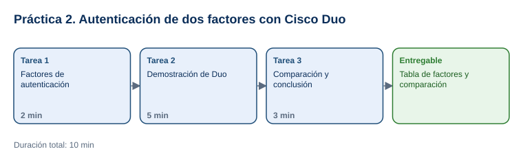

# Práctica 2. Introducción a la Autenticación de Dos Factores | Cisco Duo

**Capítulo 1. Introducción a la Ingeniería Social · Práctica 2 de 5**

⏱️ **Duración:** 10 min · 🛠️ **Herramienta:** Demostraciones interactivas de Cisco Duo · 📄 **Entregable:** `MFA_[INICIALES].docx`

## Descripción

En la Práctica 1, los atacantes obtuvieron contraseñas por teléfono. Si las cuentas hubieran exigido un segundo factor, la contraseña robada no habría bastado. En esta práctica el participante clasificará los factores de autenticación, recorrerá una demostración interactiva de Cisco Duo para ver cómo una notificación push agrega una segunda capa de seguridad y comparará la autenticación tradicional con la multifactor.

## Objetivos de aprendizaje

Al finalizar la práctica, el participante será capaz de:

- Clasificar elementos de autenticación en algo que sabes, algo que tienes y algo que eres.
- Describir el flujo de inicio de sesión con un segundo factor (notificación push de Duo).
- Explicar la diferencia entre autenticación tradicional y autenticación multifactor, y qué riesgo reduce cada una.

## Antes de empezar

| Elemento | Valor |
|---|---|
| Dónde trabajar | Navegador web: [duo.com/demos](https://duo.com/demos) |
| Archivos de la práctica | [Plantilla_MFA.docx](recursos/Plantilla_MFA.docx) |
| Carpeta de trabajo | `Documentos\Taller_Ciberseguridad\Practica02\` |
| Dato clave | 2FA o MFA: dos o más factores de **categorías distintas** (dos contraseñas no son 2FA) |
| Nombre del entregable | `MFA_[INICIALES].docx` |

> Las demostraciones de Duo son recorridos interactivos: no requieren cuenta ni instalar aplicaciones.

---

## Tarea 1. Factores de autenticación (2 min)

**Objetivo:** Tener la tabla **1. Clasificación de factores** con los 8 elementos clasificados.

**Por qué:** La seguridad de MFA depende de combinar factores de categorías distintas.

**Paso 1.** Descargar [Plantilla_MFA.docx](recursos/Plantilla_MFA.docx) en `Documentos\Taller_Ciberseguridad\Practica02\` y guardarla como `MFA_[INICIALES].docx`.

**Paso 2.** Clasificar cada elemento de la tabla 1 como **algo que sabes** (conocimiento), **algo que tienes** (posesión) o **algo que eres** (inherencia).

- **Verificación:** contraseña, PIN y pregunta secreta son *algo que sabes*; código de app, llave USB y notificación push son *algo que tienes*; huella y rostro son *algo que eres*.

**Al terminar esta tarea debes tener:**

- ✔ Los 8 elementos clasificados.

---

## Tarea 2. Demostración de Cisco Duo (5 min)

**Objetivo:** Responder la sección **2. Observaciones de la demostración de Duo** con el flujo observado.

**Por qué:** Ver el inicio de sesión con push permite entender qué tendría que hacer un atacante que solo tiene la contraseña.

**Paso 1.** Abrir [Multi-Factor Authentication (MFA) with Duo Push](https://duo.com/demos/multi-factor-authentication-mfa-with-duo-push) y seleccionar **Start** o el primer elemento resaltado de la demostración.

- **Qué verás:** una demostración paso a paso con indicaciones resaltadas que avanzan con cada clic.
- **Si aparece un aviso de cookies:** seleccionar la opción que solo acepta las cookies necesarias.

**Paso 2.** Seguir las indicaciones de la demostración hasta completar el inicio de sesión. Anotar el orden: usuario y contraseña, solicitud del segundo factor, notificación en el teléfono, aprobación y acceso.

**Paso 3.** Abrir [Duo Universal Prompt](https://duo.com/demos/duo-universal-prompt) y recorrerla para observar las opciones de segundo factor que ofrece (push, código, llave de seguridad u otras que muestre).

**Paso 4.** Responder las 3 preguntas de la sección 2 de la plantilla.

- **Importante:** para la pregunta "¿Qué pasa si el usuario rechaza una solicitud que no inició?", considere que una notificación inesperada indica que alguien ya tiene su contraseña: se rechaza y se reporta al área de seguridad.

**Al terminar esta tarea debes tener:**

- ✔ Los pasos del inicio de sesión con Duo Push anotados en orden.
- ✔ La sección 2 respondida.

---

## Tarea 3. Comparación y conclusión (3 min)

**Objetivo:** Completar la tabla **3. Comparación** y guardar el entregable.

**Por qué:** Comparar ambos métodos muestra por qué MFA reduce el impacto del robo de contraseñas visto en la Práctica 1.

**Paso 1.** Llenar la tabla 3: qué necesita el atacante en cada método, cuánto protege ante el robo de contraseña y qué riesgo permanece (por ejemplo, aprobar por error una notificación o entregar un código por teléfono).

**Paso 2.** Guardar el documento en `Documentos\Taller_Ciberseguridad\Practica02\`.

**Al terminar esta tarea debes tener:**

- ✔ La tabla de comparación completa y el archivo guardado.

---

## Validación y pruebas

| Caso | Acción | Resultado esperado |
|---|---|---|
| Factores | Revisar la tabla 1 | 3 elementos de "sabes", 3 de "tienes" y 2 de "eres" |
| Flujo de Duo | Revisar la sección 2 | El segundo factor se solicita después de la contraseña y antes del acceso |
| Caso adversarial | Pregunta del instructor: *"Si uso contraseña y pregunta secreta, ¿tengo 2FA?"* | No: ambos son "algo que sabes" |

## Entregables

| Entregable | Contenido | Criterio de verificación |
|---|---|---|
| `MFA_[INICIALES].docx` | Clasificación de factores, observaciones de Duo y comparación | 8 factores bien clasificados; flujo de Duo en orden; comparación con el riesgo restante |

## Resultado esperado

- El participante explica cómo un segundo factor evita que una contraseña robada sea suficiente para entrar.
- Reconoce que MFA no elimina la ingeniería social: los usuarios no deben aprobar solicitudes que no iniciaron ni compartir códigos.

## Solución de problemas

**La demostración no carga**
- *Síntoma:* la página queda en blanco o no avanza.
- *Causa:* bloqueador de contenido o red corporativa.
- *Solución:* desactivar el bloqueador para duo.com, usar otro navegador o seguir la demostración que proyecte el instructor.

**La demostración está en inglés**
- *Síntoma:* las indicaciones no están en español.
- *Causa:* las demostraciones solo existen en inglés.
- *Solución:* usar la traducción del navegador (clic derecho > **Traducir al español**).

## Limpieza

- Conservar el entregable en `Documentos\Taller_Ciberseguridad\Practica02\`.

## Recursos opcionales

- [CISA: More than a Password (MFA)](https://www.cisa.gov/topics/cybersecurity-best-practices/multifactor-authentication)
- [Cisco Duo: demostraciones interactivas](https://duo.com/demos)

Complejidad: Fácil · Nivel de Bloom: Comprender

---

[⬅ Anterior: Práctica 1](../Capitulo01/README.md) | [Inicio](../README.md) | [Siguiente: Práctica 3 ➡](../Capitulo03/README.md)
