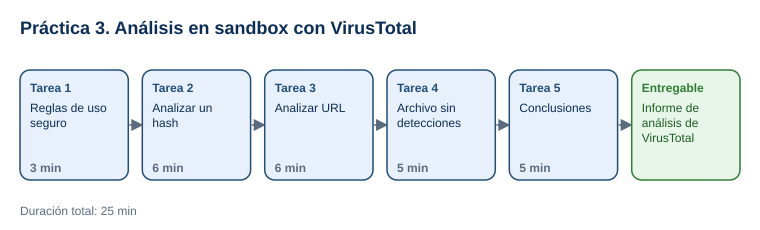

# Práctica 3. Aplicación de uso de inteligencia (sandbox)

**Capítulo 1. Introducción a la Ingeniería Social · Práctica 3 de 5**

⏱️ **Duración:** 25 min · 🛠️ **Herramienta:** VirusTotal · 📄 **Entregable:** `Analisis_VirusTotal_[INICIALES].docx`

## Descripción

Un usuario recibe un correo de la "Mesa de Ayuda TI" con un enlace y un archivo adjunto. Antes de abrir nada, el participante analizará los indicadores en VirusTotal, un servicio que revisa archivos y enlaces con decenas de motores antivirus y, cuando hay información, muestra el comportamiento observado en entornos aislados (sandbox). Interpretará las detecciones, comprobará que "0 detecciones" no significa "seguro" y emitirá un veredicto sobre el correo.

## Objetivos de aprendizaje

Al finalizar la práctica, el participante será capaz de:

- Explicar qué es un sandbox y por qué permite analizar archivos y enlaces sin poner en riesgo el equipo.
- Consultar en VirusTotal un hash y una URL, e interpretar detecciones, nombres de amenaza y comportamiento.
- Reconocer los límites del análisis automatizado y las reglas de privacidad al usar servicios públicos.

## Antes de empezar

| Elemento | Valor |
|---|---|
| Dónde trabajar | Navegador web: [virustotal.com](https://www.virustotal.com/) |
| Archivos de la práctica | [Correo_Sospechoso.pdf](recursos/Correo_Sospechoso.pdf), [Factura_Pendiente_Demo.pdf](recursos/Factura_Pendiente_Demo.pdf), [Plantilla_Analisis_VirusTotal.docx](recursos/Plantilla_Analisis_VirusTotal.docx) |
| Carpeta de trabajo | `Documentos\Taller_Ciberseguridad\Practica03\` |
| Dato clave | Hash SHA-256 del archivo de prueba EICAR: `275a021bbfb6489e54d471899f7db9d1663fc695ec2fe2a2c4538aabf651fd0f` |
| Nombre del entregable | `Analisis_VirusTotal_[INICIALES].docx` |

> **Seguridad:** en esta práctica **no** se descarga ningún archivo malicioso ni se abre el enlace del correo. EICAR es un archivo de prueba estándar e inofensivo, que los antivirus detectan a propósito. `Factura_Pendiente_Demo.pdf` es un archivo inofensivo creado para el taller.

---

## Tarea 1. Reglas de uso seguro (3 min)

**Objetivo:** Conocer qué se puede y qué no se debe enviar a VirusTotal.

**Por qué:** Todo lo que se sube a VirusTotal queda disponible para la comunidad de seguridad; subir un documento confidencial lo expone.

**Paso 1.** Descargar los tres archivos en `Documentos\Taller_Ciberseguridad\Practica03\` y guardar la plantilla como `Analisis_VirusTotal_[INICIALES].docx`.

**Paso 2.** Abrir `Correo_Sospechoso.pdf` y leer el correo y la sección **Indicadores para analizar**.

**Paso 3.** Leer estas reglas, que se aplicarán en toda la práctica:
   - Buscar primero por **hash** o **URL**: no expone el contenido.
   - **No subir** archivos internos o con datos personales, contratos, facturas reales o código propio.
   - Nunca abrir un enlace sospechoso para "ver qué pasa": se analiza en VirusTotal.

**Al terminar esta tarea debes tener:**

- ✔ Los archivos descargados y la plantilla renombrada.
- ✔ Identificados los 2 indicadores del correo: el hash y la URL real del enlace.

---

## Tarea 2. Analizar un hash (6 min)

**Objetivo:** Llenar la sección **1. Análisis del hash** con detecciones, nombres, tipo de archivo y comportamiento.

**Por qué:** El hash es la "huella digital" de un archivo; consultarlo permite saber si es malicioso sin tener el archivo.

**Paso 1.** Abrir [virustotal.com](https://www.virustotal.com/), seleccionar la pestaña **SEARCH**, pegar el hash `275a021bbfb6489e54d471899f7db9d1663fc695ec2fe2a2c4538aabf651fd0f` y presionar **Enter**.

- **Qué verás:** un círculo rojo con un número alto de detecciones (alrededor de 60 de 70 motores) y la etiqueta del archivo `eicar.com`.
- **Si aparece un aviso de cookies o un CAPTCHA:** aceptar solo las cookies necesarias y resolver el CAPTCHA manualmente.

**Paso 2.** En la pestaña **DETECTION**, anotar en la plantilla el número de detecciones y 3 nombres de detección (por ejemplo, `EICAR-Test-File`).

**Paso 3.** Seleccionar la pestaña **DETAILS** y anotar el tipo de archivo, el tamaño y la fecha **First Submission**.

**Paso 4.** Seleccionar la pestaña **BEHAVIOR**: es el resultado de ejecutar el archivo en sandboxes. Anotar si hay informes de sandbox y qué muestran; si no hay, escribir "Sin informes de comportamiento".

**Al terminar esta tarea debes tener:**

- ✔ La sección 1 completa con al menos 5 datos.

---

## Tarea 3. Analizar una URL (6 min)

**Objetivo:** Llenar la sección **2. Análisis de la URL**.

**Por qué:** En el correo, el texto del enlace no coincide con su destino real; es una señal clásica de phishing.

**Paso 1.** En VirusTotal, seleccionar **SEARCH**, pegar la URL real del correo `http://secure.eicar.org/eicar.com.txt` y presionar **Enter**.

- **Qué verás:** un informe de URL con un número menor de detecciones (alrededor de 10 de más de 90 motores) y categorías asignadas.
- **Importante:** no abrir la URL en el navegador.

**Paso 2.** Anotar las detecciones, las categorías y, en **DETAILS**, el dominio y la dirección IP final.

**Paso 3.** Comparar: ¿por qué la URL tiene menos detecciones que el archivo? Anotar una explicación breve (los motores de URL evalúan reputación y contenido de forma distinta a los antivirus de archivos).

**Al terminar esta tarea debes tener:**

- ✔ La sección 2 completa y la comparación anotada.

---

## Tarea 4. Archivo sin detecciones (5 min)

**Objetivo:** Llenar la sección **3. Archivo sin detecciones**.

**Por qué:** Un resultado limpio puede deberse a que el archivo es nuevo o a que la amenaza aún no tiene firmas; no es una garantía.

**Paso 1.** En VirusTotal, seleccionar **FILE** > **Choose file** y subir `Factura_Pendiente_Demo.pdf`. Aceptar los términos si se solicitan.

- **Qué verás:** el análisis con 0 detecciones (o muy pocas) y el SHA-256 del archivo.
- **Alternativa:** si su red no permite subir archivos, buscar el hash que el instructor proyecte del mismo archivo.

**Paso 2.** Anotar el SHA-256 y las detecciones.

**Paso 3.** Responder en la plantilla por qué 0 detecciones no garantiza que un archivo sea seguro (por ejemplo, malware nuevo, archivos cifrados o con contraseña, ataques dirigidos que nunca se han visto).

**Al terminar esta tarea debes tener:**

- ✔ La sección 3 completa.

---

## Tarea 5. Conclusiones (5 min)

**Objetivo:** Emitir el veredicto del correo y guardar el entregable.

**Por qué:** El objetivo del análisis es decidir qué hacer con el correo y cómo orientar al usuario.

**Paso 1.** En la sección **4. Conclusiones**, escribir el veredicto del correo con al menos 3 argumentos (remitente externo que imita a TI, urgencia, enlace que no coincide, detecciones de la URL).

**Paso 2.** Escribir qué no se debe subir a VirusTotal y la acción recomendada al usuario (no abrir, reportar al área de seguridad, eliminar).

**Paso 3.** Compartir el veredicto con el grupo y guardar el documento.

**Al terminar esta tarea debes tener:**

- ✔ El veredicto con argumentos y el archivo guardado.

---

## Validación y pruebas

| Caso | Acción | Resultado esperado |
|---|---|---|
| Hash conocido | Buscar el hash EICAR | Muchas detecciones con nombres que incluyen "EICAR" |
| Archivo nuevo | Subir `Factura_Pendiente_Demo.pdf` | 0 o muy pocas detecciones |
| Caso adversarial | Pregunta del instructor: *"Si el antivirus no detecta nada, ¿abro el adjunto?"* | No: se valida el remitente por un canal oficial y se reporta |

## Entregables

| Entregable | Contenido | Criterio de verificación |
|---|---|---|
| `Analisis_VirusTotal_[INICIALES].docx` | Secciones 1 a 4 de la plantilla | Detecciones y nombres del hash; datos de la URL; SHA-256 del archivo limpio; veredicto con 3 argumentos y reglas de privacidad |

## Resultado esperado

- El participante interpreta un informe de VirusTotal (detecciones, detalles y comportamiento) sin exponer el equipo ni información confidencial.
- Entiende que las detecciones son un indicio, no una prueba absoluta.

## Solución de problemas

**VirusTotal muestra "Item not found"**
- *Síntoma:* la búsqueda no encuentra el hash o la URL.
- *Causa:* el valor se copió incompleto o con espacios.
- *Solución:* copiar el valor de la sección **Antes de empezar** y pegarlo de nuevo.

**La red bloquea la subida de archivos**
- *Síntoma:* error al subir el archivo.
- *Causa:* políticas de la red corporativa.
- *Solución:* hacer la Tarea 4 con la búsqueda por hash que proyecte el instructor.

## Limpieza

- Conservar el entregable en `Documentos\Taller_Ciberseguridad\Practica03\`.
- No reenviar el correo de práctica ni intentar abrir la URL.

## Recursos opcionales

- [VirusTotal: How it works](https://docs.virustotal.com/docs/how-it-works)
- [EICAR: archivo de prueba antimalware](https://www.eicar.org/download-anti-malware-testfile/)

Complejidad: Fácil · Nivel de Bloom: Analizar

---

[⬅ Anterior: Práctica 2](../Capitulo02/README.md) | [Inicio](../README.md) | [Siguiente: Práctica 4 ➡](../Capitulo04/README.md)
