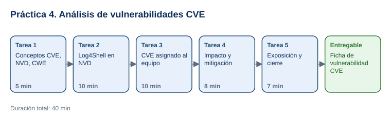

# Práctica 4. Introducción al análisis de vulnerabilidades CVE

**Capítulo 1. Introducción a la Ingeniería Social · Práctica 4 de 5**

⏱️ **Duración:** 40 min · 🛠️ **Herramienta:** National Vulnerability Database (NVD) · 📄 **Entregable:** `Ficha_CVE_[EQUIPO].docx`

## Descripción

Cada día se publican vulnerabilidades nuevas en software que usan empresas y personas. El sistema CVE (Common Vulnerabilities and Exposures) les asigna un identificador único y la NVD del NIST agrega severidad, tipo de debilidad y productos afectados. En esta práctica el grupo analizará juntos la vulnerabilidad Log4Shell y después cada equipo investigará una vulnerabilidad real, documentará su impacto y la mitigación recomendada, y la presentará al grupo.

## Objetivos de aprendizaje

Al finalizar la práctica, el participante será capaz de:

- Explicar qué es un CVE y qué información agregan la NVD (severidad, CWE, productos afectados) y el catálogo KEV de CISA.
- Buscar una vulnerabilidad publicada en la NVD e interpretar su descripción, severidad y productos afectados.
- Proponer medidas de mitigación y argumentar la prioridad de atención de una vulnerabilidad.

## Antes de empezar

| Elemento | Valor |
|---|---|
| Dónde trabajar | Navegador web: [nvd.nist.gov](https://nvd.nist.gov/vuln/search) |
| Archivos de la práctica | [CVE_Asignados.xlsx](recursos/CVE_Asignados.xlsx), [Plantilla_Ficha_CVE.docx](recursos/Plantilla_Ficha_CVE.docx) |
| Carpeta de trabajo | `Documentos\Taller_Ciberseguridad\Practica04\` |
| Dato clave | CVE de demostración: `CVE-2021-44228` (Log4Shell) |
| Nombre del entregable | `Ficha_CVE_[EQUIPO].docx` (por ejemplo, `Ficha_CVE_Equipo3.docx`) |

> **Nota para el instructor:** formar equipos de 2 o 3 participantes y asignar a cada uno un CVE de la hoja `CVE_por_equipo`. Si hay más de 6 equipos, repetir CVE.

---

## Tarea 1. Conceptos CVE, NVD, CWE y KEV (5 min)

**Objetivo:** Distinguir los cuatro términos que aparecerán en la ficha.

**Por qué:** Cada sitio aporta una parte distinta de la información que se necesita para decidir qué atender primero.

**Paso 1.** Descargar los archivos y guardar la plantilla como `Ficha_CVE_[EQUIPO].docx`.

**Paso 2.** Revisar con el instructor estos conceptos:

| Término | Qué es |
|---|---|
| **CVE** | Identificador único de una vulnerabilidad publicada (formato `CVE-año-número`). Lo asigna un CNA, como el fabricante del producto. |
| **NVD** | Base de datos del NIST que enriquece cada CVE con severidad CVSS, tipo de debilidad y productos afectados (CPE). |
| **CWE** | Catálogo de tipos de debilidad de software (por ejemplo, CWE-125: lectura fuera de límites). |
| **KEV** | Catálogo de CISA de vulnerabilidades con **explotación conocida**: deben atenderse con prioridad. |

**Al terminar esta tarea debes tener:**

- ✔ Claro que un mismo CVE puede tener un puntaje del CNA y otro de la NVD.

---

## Tarea 2. Análisis guiado de Log4Shell (10 min)

**Objetivo:** Ubicar en la página de NVD los datos de la ficha usando CVE-2021-44228 como ejemplo.

**Por qué:** Conocer dónde está cada dato permite que cada equipo analice su CVE de forma autónoma.

**Paso 1.** Abrir [nvd.nist.gov/vuln/search](https://nvd.nist.gov/vuln/search), escribir `CVE-2021-44228` en **Keyword Search** y seleccionar **Search**. Hacer clic en el identificador del resultado.

- **Qué verás:** la página [CVE-2021-44228](https://nvd.nist.gov/vuln/detail/CVE-2021-44228) con un aviso de que la vulnerabilidad está en el catálogo KEV de CISA.

**Paso 2.** Identificar con el instructor cada sección:
   - **Description:** Apache Log4j2 permite a un atacante ejecutar código de forma remota mediante mensajes de registro manipulados (función JNDI).
   - **Metrics > CVSS Version 3.x:** puntaje **10.0 CRITICAL** de NVD.
   - **Weakness Enumeration:** CWE-917, CWE-502, CWE-20 y CWE-400.
   - **Known Affected Software Configurations:** versiones de Apache Log4j afectadas.
   - **References:** avisos del fabricante, parches y herramientas.

**Paso 3.** Seleccionar el enlace del aviso de Apache en **References** y ubicar la versión que corrige la vulnerabilidad.

**Al terminar esta tarea debes tener:**

- ✔ Ubicadas las 5 secciones de la página y el aviso KEV.

---

## Tarea 3. Investigación del CVE asignado (10 min)

**Objetivo:** Llenar las secciones **1. Identificación**, **2. Severidad** y **3. Productos afectados** de la ficha.

**Por qué:** Documentar una vulnerabilidad real de forma estructurada es la base para comunicarla a quien debe corregirla.

**Paso 1.** Abrir `CVE_Asignados.xlsx` y ubicar el CVE de su equipo.

**Paso 2.** Buscar el CVE en la NVD como en la Tarea 2.

**Paso 3.** Llenar la ficha:
   - Identificador, nombre común, fecha de publicación y descripción en sus palabras.
   - CWE de **Weakness Enumeration**.
   - Puntaje CVSS 3.x de NVD y, si aparece, el del CNA (por ejemplo, Microsoft o Citrix). Si son distintos, anotar ambos.
   - Vector CVSS completo (texto que empieza con `CVSS:3.1/`).
   - Al menos 2 productos o versiones afectadas.

**Al terminar esta tarea debes tener:**

- ✔ Las secciones 1 a 3 de la ficha completas.

---

## Tarea 4. Impacto y mitigación (8 min)

**Objetivo:** Llenar la sección **4. Impacto y mitigación** con fuentes.

**Por qué:** Identificar una vulnerabilidad sirve de poco si no se sabe qué hacer y con qué urgencia.

**Paso 1.** Leer la descripción y escribir qué podría lograr un atacante (leer datos, ejecutar código, interrumpir el servicio).

**Paso 2.** Abrir el [catálogo KEV de CISA](https://www.cisa.gov/known-exploited-vulnerabilities-catalog), buscar el CVE y anotar si aparece y la acción requerida.

**Paso 3.** En **References** de la NVD, abrir el aviso del fabricante (etiquetas **Vendor Advisory** o **Patch**) y anotar la actualización o mitigación recomendada con su enlace.

**Paso 4.** Escribir la prioridad de atención para una empresa que usa el producto y justificarla con el puntaje, el KEV y la exposición del producto a Internet.

**Al terminar esta tarea debes tener:**

- ✔ La sección 4 con fuente del fabricante y decisión de prioridad.

---

## Tarea 5. Exposición y cierre (7 min)

**Objetivo:** Presentar el CVE al grupo en 1 minuto y guardar la ficha.

**Por qué:** Comparar los casos muestra que vulnerabilidades distintas comparten patrones: productos expuestos a Internet, actualizaciones tardías y explotación activa.

**Paso 1.** Cada equipo presenta: qué es, qué afecta, severidad, si está en KEV y qué hacer.

**Paso 2.** En grupo, identificar qué tienen en común los CVE presentados.

**Paso 3.** Guardar la ficha en `Documentos\Taller_Ciberseguridad\Practica04\`.

**Al terminar esta tarea debes tener:**

- ✔ La ficha completa y guardada.

---

## Validación y pruebas

| CVE | Puntaje NVD (CVSS 3.1) | CWE principal | En KEV |
|---|---|---|---|
| CVE-2021-44228 | 10.0 Crítica | CWE-917 | Sí |
| CVE-2014-0160 | 7.5 Alta | CWE-125 | Sí |
| CVE-2017-0144 | 8.8 Alta | Sin información de NVD (NVD-CWE-noinfo) | Sí |
| CVE-2019-0708 | 9.8 Crítica | CWE-416 | Sí |
| CVE-2021-26855 | 9.8 Crítica (CNA Microsoft: 9.1) | CWE-918 | Sí |
| CVE-2023-4966 | 7.5 Alta (CNA Citrix: 9.4) | CWE-119 | Sí |
| CVE-2024-3400 | 10.0 Crítica | CWE-77 y CWE-20 | Sí |

> Valores consultados en la NVD en noviembre de 2026. La NVD puede actualizar puntajes y referencias; si cambian, prevalece lo publicado en la NVD.

**Caso adversarial:** pregunta del instructor *"Si el puntaje del CNA es más bajo, ¿podemos esperar a atenderlo?"*. Respuesta esperada: no; si está en KEV y el producto está expuesto, se atiende con prioridad sin importar la diferencia de puntajes.

## Entregables

| Entregable | Contenido | Criterio de verificación |
|---|---|---|
| `Ficha_CVE_[EQUIPO].docx` | Identificación, severidad, productos afectados, impacto y mitigación | Datos coinciden con la NVD; incluye CWE, vector CVSS, estado KEV, mitigación con enlace del fabricante y prioridad justificada |

## Resultado esperado

- Cada equipo documenta un CVE real con datos verificables.
- El grupo reconoce la importancia de actualizar y priorizar las vulnerabilidades con explotación conocida.

## Solución de problemas

**La búsqueda en la NVD no devuelve resultados**
- *Síntoma:* "There are 0 matching records".
- *Causa:* el identificador se escribió con espacios o con guiones distintos.
- *Solución:* escribir el CVE exactamente como `CVE-2014-0160`.

**La página de la NVD tarda o muestra error**
- *Síntoma:* tiempo de espera agotado.
- *Causa:* alta demanda del sitio.
- *Solución:* recargar en un minuto o consultar el mismo CVE en [cve.org](https://www.cve.org/) y el estado en el catálogo KEV.

## Limpieza

- Conservar la ficha en `Documentos\Taller_Ciberseguridad\Practica04\`; se usa en la Práctica 5.

## Recursos opcionales

- [CVE Program](https://www.cve.org/)
- [CWE: lista de debilidades](https://cwe.mitre.org/)
- [CISA Known Exploited Vulnerabilities Catalog](https://www.cisa.gov/known-exploited-vulnerabilities-catalog)

Complejidad: Intermedia · Nivel de Bloom: Analizar

---

[⬅ Anterior: Práctica 3](../Capitulo03/README.md) | [Inicio](../README.md) | [Siguiente: Práctica 5 ➡](../Capitulo05/README.md)
