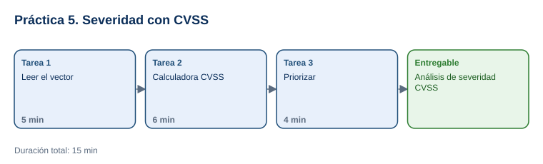

# Práctica 5. Introducción al análisis de severidad de vulnerabilidades con CVSS

**Capítulo 1. Introducción a la Ingeniería Social · Práctica 5 de 5**

⏱️ **Duración:** 15 min · 🛠️ **Herramienta:** National Vulnerability Database y calculadora oficial de CVSS (FIRST) · 📄 **Entregable:** `Analisis_CVSS_[INICIALES].xlsx`

## Descripción

En la Práctica 4 cada equipo obtuvo el puntaje CVSS de un CVE. Ahora el participante entenderá de dónde sale ese número: descompondrá el vector de Heartbleed (CVE-2014-0160), lo reproducirá en la calculadora oficial de FIRST, observará cómo cambia el puntaje al modificar una métrica y usará el resultado para priorizar tres vulnerabilidades.

## Objetivos de aprendizaje

Al finalizar la práctica, el participante será capaz de:

- Interpretar las métricas de un vector CVSS 3.1: vector de ataque, complejidad, privilegios, interacción del usuario, alcance e impacto en confidencialidad, integridad y disponibilidad.
- Calcular un puntaje con la calculadora oficial y explicar por qué cambia al modificar una métrica.
- Priorizar vulnerabilidades combinando el puntaje CVSS con la explotación conocida (KEV).

## Antes de empezar

| Elemento | Valor |
|---|---|
| Dónde trabajar | Navegador web: [CVE-2014-0160 en NVD](https://nvd.nist.gov/vuln/detail/CVE-2014-0160) y [calculadora CVSS 3.1 de FIRST](https://www.first.org/cvss/calculator/3.1) |
| Archivos de la práctica | [Plantilla_Analisis_CVSS.xlsx](recursos/Plantilla_Analisis_CVSS.xlsx) |
| Carpeta de trabajo | `Documentos\Taller_Ciberseguridad\Practica05\` |
| Dato clave | Vector de Heartbleed: `CVSS:3.1/AV:N/AC:L/PR:N/UI:N/S:U/C:H/I:N/A:N` (7.5 Alta) |
| Nombre del entregable | `Analisis_CVSS_[INICIALES].xlsx` |

**Escala de severidad CVSS 3.1:** 0.0 Ninguna · 0.1 a 3.9 Baja · 4.0 a 6.9 Media · 7.0 a 8.9 Alta · 9.0 a 10.0 Crítica.

---

## Tarea 1. Leer el vector (5 min)

**Objetivo:** Completar la hoja `Vector_Heartbleed` con el efecto de cada métrica.

**Por qué:** El puntaje es el resultado de 8 decisiones; entenderlas permite explicar la severidad y no solo citar un número.

**Paso 1.** Descargar la plantilla y guardarla como `Analisis_CVSS_[INICIALES].xlsx`.

**Paso 2.** Abrir [CVE-2014-0160 en NVD](https://nvd.nist.gov/vuln/detail/CVE-2014-0160) y, en **Metrics > CVSS Version 3.x**, comprobar el puntaje **7.5 HIGH** y el vector.

**Paso 3.** En la hoja `Vector_Heartbleed`, escribir en la última columna por qué cada valor hace la vulnerabilidad más o menos grave. Ejemplos:
   - `AV:N`: se explota por la red, desde Internet; más grave.
   - `I:N` y `A:N`: no modifica datos ni detiene el servicio; por eso no llega a 9 o 10.

**Al terminar esta tarea debes tener:**

- ✔ Las 8 métricas explicadas.

---

## Tarea 2. Calculadora CVSS (6 min)

**Objetivo:** Completar la hoja `Calculadora` con 4 escenarios.

**Por qué:** Cambiar una métrica muestra qué condición del entorno reduce o aumenta el riesgo.

**Paso 1.** Abrir la [calculadora CVSS 3.1 de FIRST](https://www.first.org/cvss/calculator/3.1) y seleccionar los valores del vector original de Heartbleed.

- **Qué verás:** el puntaje **7.5** y el vector en la parte superior.

**Paso 2.** Cambiar **Attack Vector** a **Adjacent Network (A)** y anotar el puntaje y la severidad.

- **Resultado esperado:** **6.5 Media**: si el atacante debe estar en la misma red local, el riesgo baja.

**Paso 3.** Mantener `AV:A` y cambiar **Integrity** a **High (H)**. Anotar el resultado.

- **Resultado esperado:** **8.1 Alta**: además de leer, el atacante podría modificar información.

**Paso 4.** Elegir libremente una métrica, cambiarla y anotar el vector, el puntaje y su observación.

**Al terminar esta tarea debes tener:**

- ✔ 4 escenarios con vector, puntaje y severidad.

---

## Tarea 3. Priorizar (4 min)

**Objetivo:** Completar la hoja `Priorizacion` con el orden de atención de 3 CVE.

**Por qué:** En una organización real los recursos son limitados; la priorización decide qué se corrige primero.

**Paso 1.** Anotar el puntaje NVD de CVE-2014-0160 (7.5), CVE-2017-0144 (8.8) y CVE-2021-44228 (10.0), y si están en el catálogo KEV (los tres están).

**Paso 2.** Asignar la prioridad 1, 2 o 3 y justificarla: además del puntaje, considerar si el producto está expuesto a Internet y si existe explotación conocida.

**Paso 3.** Guardar el archivo en `Documentos\Taller_Ciberseguridad\Practica05\`.

**Al terminar esta tarea debes tener:**

- ✔ Los 3 CVE priorizados con justificación y el archivo guardado.

---

## Validación y pruebas

| Caso | Vector | Puntaje esperado |
|---|---|---|
| Original | `CVSS:3.1/AV:N/AC:L/PR:N/UI:N/S:U/C:H/I:N/A:N` | 7.5 Alta |
| Cambio 1 | `CVSS:3.1/AV:A/AC:L/PR:N/UI:N/S:U/C:H/I:N/A:N` | 6.5 Media |
| Cambio 2 | `CVSS:3.1/AV:A/AC:L/PR:N/UI:N/S:U/C:H/I:H/A:N` | 8.1 Alta |
| Caso adversarial | Pregunta del instructor: *"Si un CVE tiene 6.5, ¿lo podemos ignorar?"* | No: un puntaje medio en KEV o en un sistema crítico expuesto puede requerir atención inmediata |

## Entregables

| Entregable | Contenido | Criterio de verificación |
|---|---|---|
| `Analisis_CVSS_[INICIALES].xlsx` | Hojas `Vector_Heartbleed`, `Calculadora` y `Priorizacion` | 8 métricas explicadas; puntajes 6.5 y 8.1 en los cambios 1 y 2; un cambio libre; 3 CVE priorizados con justificación |

## Resultado esperado

- El participante explica por qué una vulnerabilidad tiene su puntaje y cómo cambia según las condiciones del ataque.
- Prioriza vulnerabilidades con criterio, combinando severidad, explotación conocida y exposición.

## Solución de problemas

**La calculadora muestra otro puntaje**
- *Síntoma:* el puntaje no es 7.5 con el vector original.
- *Causa:* una métrica quedó con otro valor o se usa la calculadora de la versión 4.0.
- *Solución:* comparar el vector que muestra la calculadora con el de NVD y usar la [calculadora 3.1](https://www.first.org/cvss/calculator/3.1).

**La NVD muestra además un puntaje CVSS 4.0**
- *Síntoma:* aparecen varias versiones en **Metrics**.
- *Causa:* algunas vulnerabilidades tienen puntajes en distintas versiones de CVSS.
- *Solución:* para esta práctica usar la pestaña **CVSS Version 3.x**.

## Limpieza

- Conservar el entregable en `Documentos\Taller_Ciberseguridad\Practica05\`.

## Recursos opcionales

- [FIRST: especificación de CVSS 3.1](https://www.first.org/cvss/v3.1/specification-document)
- [FIRST: calculadora CVSS 4.0](https://www.first.org/cvss/calculator/4.0)

Complejidad: Intermedia · Nivel de Bloom: Evaluar

---

[⬅ Anterior: Práctica 4](../Capitulo04/README.md) | [Inicio](../README.md)
